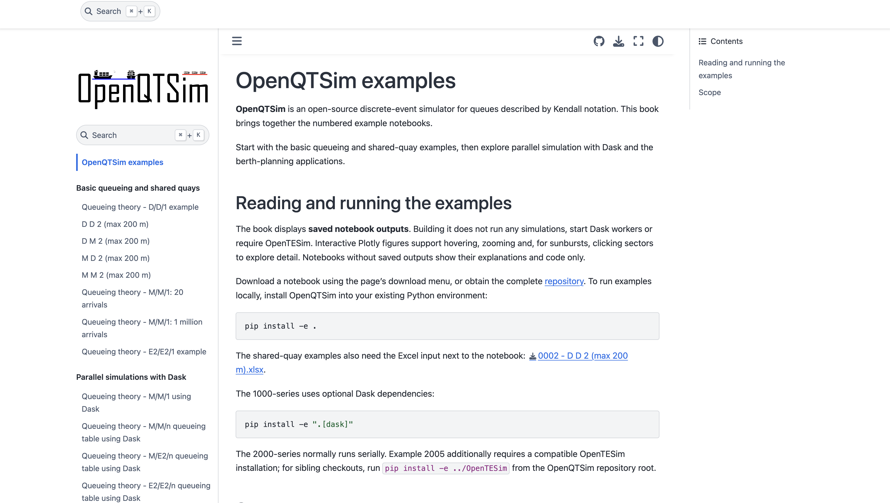

[ ](https://openqtsim.readthedocs.io)
[ ](https://github.com/TUDelft-CITG/OpenQTSim/blob/master/LICENSE.txt)
[](https://doi.org/10.5281/zenodo.3706929)

[](https://dl.circleci.com/status-badge/redirect/gh/TUDelft-CITG/OpenQTSim/tree/master)


# OpenQTSim

**Open** source **Q**ueueing **T**heory **Sim**ulation - Simulation package that facilitates discrete event simulation of queues with a Kendall notation.

Documentation can be found [here](https://openqtsim.readthedocs.io).

## Installation

To install OpenQTSim, run this command in your terminal:

``` bash
pip install openqtsim
```

This is the preferred method to install OpenQTSim, as it will always install the most recent stable release.

If you don not have [pip](https://pip.pypa.io) installed, this [Python installation guide](http://docs.python-guide.org/en/latest/starting/installation/) can guide you through the process.

You can read the [documentation](https://openqtsim.readthedocs.io/en/latest/installation.html) for other installation methods.

## Book

<a href="https://tudelft-citg.github.io/OpenQTSim/"></a>

Read the [OpenQTSim book](https://tudelft-citg.github.io/OpenQTSim/), based on the
numbered examples in the `notebooks` folder. The site is deployed by GitHub Actions
from the `example_check` branch. Its first deployment becomes available after the
workflow succeeds.

## Examples

For development and CI, install test dependencies with
`python -m pip install -e ".[testing,dask]"` and run `python -m pytest`.
The testing extra includes IPython for notebook execution and display checks.
Build API documentation with
`python -m sphinx -b html -n -W --keep-going docs docs/_build/html`
after installing `docs/requirements.txt`. Packaging uses the isolated setuptools
backend declared in `pyproject.toml`; the retired `setup.py test` and
`setup.py docs` commands are no longer used by CircleCI.

The benefit of OpenQTSim is the generic set-up. This set-up allows the simulation of a range of queues with a Kendall notation. A number of examples are presented as Jupyter Notebooks in the [notebooks](notebooks) folder.

### Queueing theory and simulation (0000-series)

1. [Queueing theory](notebooks/0001%20-%20Queueing%20theory.ipynb): Kendall notation, utilisation, stability, Little's law, service levels and analytical reference results.
2. [Simulation](notebooks/0002%20-%20Simulation.ipynb): discrete events, a worked event table, random streams, replications and interpretation of simulation statistics.

### Basic queueing examples (1000-series)

The numbered example notebooks in this repository are best read in order:

1. [D/D/1 - basics of queueing](notebooks/1001%20-%20D%20D%201%20-%20basics%20of%20queueing.ipynb): reproduces the queueing table (1 server) from the lecture slides.
2. [D/D/2 (max 200 m)](notebooks/1002%20-%20D%20D%202%20%28max%20200%20m%29.ipynb): reproduces the lecture example with 2 servers and a 200 m quay.
3. [D/M/2 (max 200 m)](notebooks/1003%20-%20D%20M%202%20%28max%20200%20m%29.ipynb): stochastic variation 1 (negative exponential service times).
4. [M/D/2 (max 200 m)](notebooks/1004%20-%20M%20D%202%20%28max%20200%20m%29.ipynb): stochastic variation 2 (negative exponential interarrival times).
5. [M/M/2 (max 200 m)](notebooks/1005%20-%20M%20M%202%20%28max%20200%20m%29.ipynb): stochastic variation 3 (both negative exponential).
6. [M/M/1 - 20 arrivals](notebooks/1006%20-%20M%20M%201%20-%2020%20arrivals.ipynb): a simple M/M/1 example.
7. [M/M/1 - 1 million arrivals](notebooks/1007%20-%20M%20M%201%20-%201%20million%20arrivals.ipynb): shows that a long run approaches the analytical solution.
8. [E2/E2/1 - 1 million arrivals](notebooks/1008%20-%20E2%20E2%201%20-%201%20million%20arrivals.ipynb): Erlang 2 interarrival and service times, compared with M/M/1 and Kingman's approximation.

### Parallel simulations with Dask (2000-series)

The 2000-series notebooks run many simulations in parallel with Dask:

1. [M/M/1 - using Dask](notebooks/2001%20-%20M%20M%201%20-%20using%20Dask.ipynb): independent replications of an M/M/1 queue (100,000 customers each), compared with the analytical solution.
2. [M/M/n - queueing table](notebooks/2002%20-%20M%20M%20n%20-%20queueing%20table.ipynb): waiting time in units of service time for 1-10 berths and 10-90 % berth occupancy (1,000,000 customers per combination), compared with the analytical M/M/n (Erlang C) table of PIANC (2014).
3. [M/E2/n - queueing table](notebooks/2003%20-%20M%20E2%20n%20-%20queueing%20table.ipynb): the same for M/E2/n, compared with the table of Groenveld (2001).
4. [E2/E2/n - queueing table](notebooks/2004%20-%20E2%20E2%20n%20-%20queueing%20table.ipynb): the same for E2/E2/n, compared with the table of Groenveld (2001).

### Practical examples (3000-series)

The 3000-series notebooks explore queue organisation and berth planning:

1. [Dedicated versus shared berths](notebooks/3001%20-%20Dedicated%20versus%20shared%20berths.ipynb): compare separate M/M/1 queues with a pooled M/M/2 queue at equal traffic and capacity.
2. [Berth occupancy and waiting time](notebooks/3002%20-%20Berth%20occupancy%20and%20waiting%20time.ipynb): the occupancy "hockey stick" for 1, 2 and 4 berths, with analytical curves and simulation checks.
3. [Berth planning by cost](notebooks/3003%20-%20Berth%20planning%20by%20cost.ipynb): balance annualised berth costs against vessel waiting costs at fixed demand.
4. [Container terminal design and costs](notebooks/3004%20-%20Container%20terminal%20design%20and%20costs.ipynb): reconstruct the *Ports and Waterways* Section 4.4 example, then separately screen berth/crane alternatives by service level and annual quay, crane and vessel costs.
5. [Container terminal lifecycle costs with OpenTESim](notebooks/3005%20-%20Container%20terminal%20lifecycle%20costs%20with%20OpenTESim.ipynb): use the actual OpenTESim asset cash-flow engine for phased construction, OPEX, replacement, residual value and discounted costs, alongside OpenQTSim service screening. Includes quay, cranes, trailers and storage stacks; distinguishes operator and wider economic perspectives.

These examples run serially by default (Dask is optional), use independent seeded
replications, and compare simulation estimates with queueing theory. Example 3004
uses E2/E2/n simulations and explicitly distinguishes the book's sizing convention
from its workload-consistent economic extension.
Example 3005 additionally requires a compatible OpenTESim installation. For sibling
checkouts, run `pip install -e ../OpenTESim` from the OpenQTSim repository root in
your existing environment. Its financial conventions follow OpenTESim notebook
0031, using a consistent constant-price basis rather than mixed escalation settings.

### Build the notebook book

The numbered notebooks can also be read as a Jupyter Book, using the same
Sphinx-based format as OpenTNSim. In your existing Python environment, run:

```bash
python -m pip install -r book/requirements.txt
python book/build.py
```

Open `book/_build/html/index.html` in a browser. All numbered notebooks are
automatically included in numerical order, grouped by series. The build uses
the notebooks' headings for navigation labels rather than their numbered filenames.
It uses
**saved outputs only**: it never reruns simulations or starts Dask workers,
and OpenTESim is not needed to build the book. Interactive Plotly figures are
preserved, with the JavaScript bundled locally. Rerun and save a notebook before
building if its results need refreshing.

Original notebooks are unchanged; generated sources and HTML are ignored by Git.
The **Build notebook book** GitHub Actions workflow builds and uploads the HTML as
an artifact. Pushes to `example_check` also publish it to
[GitHub Pages](https://tudelft-citg.github.io/OpenQTSim/); pull requests and other
branches only build artifacts. In repository **Settings > Pages**, select
**GitHub Actions** as the source, not **Deploy from a branch**. If the
`github-pages` environment restricts deployment branches, allow `example_check`.
The site URL does not contain the branch name. To publish from another branch
later, update both `example_check` deployment conditions in the workflow.
The API documentation remains on Read the Docs.

### Parallel simulations with Dask

`openqtsim.mt_engine` runs many independent simulations in parallel. `create_tasks`
creates one task per utilisation, number of servers and replication (each with its
own reproducible seeds), and `run_tasks(tasks, client)` distributes them over a
`dask.distributed.Client`. That client can be a `LocalCluster` on your computer or
a remote (HPC or cloud) cluster. `run_tasks(tasks, client, func=statistics_worker)`
returns the full statistics of every simulation instead of only the waiting time
factor. Dask is optional; install it with `pip install -e ".[dask]"`.

### Deterministic customer inputs

For a deterministic (`"D"`) arrival process, pass a pandas DataFrame containing
`IAT` (interarrival time). For deterministic service, pass a DataFrame containing
`ST` (service duration). Both use hours and pair customers by **row position**:
the first arrival uses the first service row, regardless of DataFrame index labels.
Customer IDs in the output remain one-based. Names are optional metadata, not
matching keys. The customer log includes a `name` column: names are taken by row
position from the deterministic arrival table, falling back to the deterministic
service table for missing or blank arrival names. Unnamed customers have `None`.
Gantt charts display names when available, otherwise customer IDs. Internal row
IDs keep repeated names on separate rows. Arrival times are cumulative `IAT`;
an input `AT` column is not used.

### Shared quay capacity

The quay notebooks (1002 to 1005, see the list above) read only the Excel `info`
worksheet and expand it into visits using `openqtsim.generate_vessel_tables`.
They cover fixed or negative-exponential arrivals and service.

```python
info = pd.read_excel("notebooks/1002 - D D 2 (max 200 m).xlsx", sheet_name="info")
arrival_table, service_table = openqtsim.generate_vessel_tables(
    info, nr_arrivals=20,
    arrival_distribution="D", service_distribution="M",
    arrival_seed=42, service_seed=43,
)
```

Choose exactly one limit: `nr_arrivals` (a positive integer), or
`max_duration_days` (a finite positive duration, with `nr_arrivals=None`).
The duration cutoff includes arrivals at the boundary; the simulation still
drains beyond it. No visits within the limit produces empty tables, which the
notebooks reject explicitly before simulation.

Input times are **days**; generated table times are **hours**. Each vessel's
`AT` sets its first arrival and `IAT` its return interval. With `"M"` arrivals,
these become exponential means, including the first arrival (zero `AT` means
immediate arrival). Ties use info-sheet row order. Service is fixed or
exponential with vessel-specific mean `loading + unloading`; the redundant
`ST` info column is not used. Length and patience are retained for each visit
when present.
Return visits remain scheduled independently of whether earlier visits reneged.
The two independent random streams use distinct seeds as described below.

These are per-vessel arrival streams and service distributions, not necessarily
a homogeneous textbook M/M/2 model. All sampled visits are replayed through
`ArrivalProcess("D", arrival_table)` and `ServiceProcess("D", service_table)`
so the simulator retains vessel identity and paired metadata.

`Queue(A, S, c=2, quay_length=200)` allows at most two customers in service,
with at most 200 metres of combined vessel length. `quay_length=None` (the
default) leaves ordinary queue behaviour unchanged. Supply a finite positive
`length` per customer in the deterministic arrival table, or in the deterministic
service table if the arrival table has no length column. Lengths are paired by
row position and included in the customer log when quay capacity is enabled.
Missing, nonpositive, nonfinite, or oversized lengths raise `ValueError` before
arrivals begin.

Admission requires both an available service slot and sufficient quay space;
neither is reserved while a vessel waits. Space is held throughout service
(loading and unloading) and released on departure. Strict FIFO applies when
quay capacity is enabled: a blocked vessel prevents all later arrivals from
starting, even if a shorter vessel could fit. Explicit `s_id` assignments are
also respected, with the same strict FIFO rule. The quay is modelled as a shared
length budget, not a spatial berth layout; fragmentation and clearance distances
are not modelled.

### Composing customers and service stations from mixins

Following [OpenTNSim](https://github.com/TUDelft-CITG/OpenTNSim), customers and
service stations are composed of mixins in `openqtsim.core` (recreated locally;
OpenCLSim/OpenTNSim are not required). Package structure:

* `openqtsim.core.mixins`: `Identifiable` (`name`, optional `id`),
  `HasResource` (`nr_resources`, the number of servers), `HasLength` (`length`
  of a vessel, or total length of a quay), `HasArrivalSchedule` (`AT`, `IAT`),
  `HasHandlingTimes` (`unloading`, `loading`; `service_time` is their sum),
  `HasMaxWait` (`maxwait`) and `ExtraMetadata` (stores all other keyword
  inputs in `metadata`; use it as the last mixin).
* `openqtsim.core.utils`: `create_object` and `inspect_object`.
* `openqtsim.visualizations`: `plot_gantt` and `hover_time`.

```python
from openqtsim.core import Identifiable, HasResource, HasLength, ExtraMetadata
from openqtsim.core import HasArrivalSchedule, HasHandlingTimes, HasMaxWait
from openqtsim.core import create_object, inspect_object

Quay = create_object("Quay", (Identifiable, HasResource, HasLength))
inspect_object(Quay, show_parameter_table=True)  # required and optional inputs
quay = Quay(**{"name": "Quay", "nr_resources": 2, "length": 200})

Vessel = create_object("Vessel", (Identifiable, HasLength, HasArrivalSchedule,
                                  HasHandlingTimes, HasMaxWait, ExtraMetadata))
inspect_object(Vessel, show_parameter_table=True)
vessels = [Vessel(**row) for row in info.to_dict("records")]

arrival_table, service_table = openqtsim.generate_vessel_tables(vessels, nr_arrivals=20)
q = openqtsim.Queue(A, S, station=quay)  # same as c=2, quay_length=200
```

`inspect_object(Class, candidate_kwargs=None, show_parameter_table=False)`
lists each `__init__` parameter along the class hierarchy with its mixin,
default and status (`mandatory`, `added`, `optional (used)`, `optional (unused)`
for the given `candidate_kwargs`). Without `show_parameter_table` it returns
the styled table and whether required inputs are missing.

`Queue(..., station=station)` requires `HasResource` (sets `c`) and optionally
`HasLength` (sets `quay_length`); conflicting `c`/`quay_length` values raise
`ValueError`. The station describes capacity; the simulation keeps the
occupied length and admits a vessel only when a server and enough length are
free at the same time. `generate_vessel_tables` accepts the info DataFrame or
customer objects with `Identifiable`, `HasArrivalSchedule` and
`HasHandlingTimes`; `HasLength` and `HasMaxWait` (or the `length`/`maxwait`
columns) are optional, but must be present for all customers or none.

### Reneging (maximum queue waiting time)

Supply an optional `maxwait` column in a deterministic arrival table, or in the
deterministic service table if the arrival table has no such column. Values must
be finite nonnegative numbers in simulation time units (hours in the Excel
`data` worksheet); rows are matched by position. Invalid values fail before
arrivals begin. Omit the column for unlimited patience.

A vessel that cannot start service by `AT + maxwait` leaves the queue permanently,
without reserving a server or quay space or drawing a service time. Service at
exactly the deadline is allowed; zero patience allows immediate service only.
Patience stops applying once service starts. Pending FIFO requests are removed
when a vessel reneges, including requests behind the head of the queue.
Shared quay admission remains strict global FIFO, including explicit server
assignments. Without a quay constraint, the existing per-server assignment
behaviour is preserved: vessels assigned to another free server may proceed.

The log includes `status` (`served` or `reneged`), `maxwait`, and `departure`.
For reneged vessels, `TSB`, `TSE`, `ST`, `ITS`, and `s_id` are missing, `TCWQ`
is the actual wait, and `TCSS` equals that wait. The 20-vessel quay example
plots waiting up to reneging and marks its time with a red cross; no service
bar is drawn for that visit.

Without an `s_id` column, customers take any available server in FIFO order.
With `s_id`, each customer waits for the specified server, numbered from 1 to `c`.
Customers waiting for the same server are served in arrival order; customers
assigned to other available servers can proceed without waiting for them.

```python
import pandas as pd
import openqtsim

arrivals = pd.DataFrame({"IAT": [0, 1, 1]})
services = pd.DataFrame({"ST": [10, 2, 3], "s_id": [2, 2, 1]})
queue = openqtsim.Queue(
    openqtsim.ArrivalProcess("D", arrivals),
    openqtsim.ServiceProcess("D", services),
    c=2,
)
simulation = openqtsim.Simulation(queue)
simulation.run(len(arrivals))
customers, system = simulation.return_log()
```

Each deterministic table must contain at least as many rows as the requested
arrivals. Missing rows, missing required columns, and invalid server assignments
raise `ValueError` before arrivals are generated. Do not subtract one from the
input row count to avoid the end of a deterministic service table.

### Supported configurations and input validation

The simulator currently supports `"M"`, `"D"`, and Erlang symbols such as `"E1"`
or `"E2"` (a positive integer order without leading zeros). Stochastic rates must
be finite positive numbers; service rates are per server. Deterministic `IAT` and
`ST` values must be finite nonnegative numbers; zero durations are allowed.
Tables must have unique column names.

Only infinite capacity (`K=np.inf`), infinite calling population (`N=np.inf`),
FIFO discipline (`D="FIFO"`), and `priority=False` are implemented. Unsupported
settings raise `ValueError` rather than silently simulating a different queue.
Server counts and requested arrival counts must be positive integers, not booleans
or fractional values. Seeds must be `None` or integers from 0 through `2**32 - 1`.
Queue/process inputs are checked at construction and checked again before running;
deterministic row counts and server assignments are checked before arrivals begin.
The fast `MM1` solver also validates rates, counts, seeds, and supplied durations.

Finite runs with arrival rates at or above total service capacity remain allowed.
They model a growing queue, not a stable steady state. Waiting-factor lookup
helpers only support M/M, M/E2, and E2/E2 distribution pairs.

### Independent arrival and service random streams

Both simulators accept separate keyword-only seeds:

```python
simulation = openqtsim.Simulation(queue, arrival_seed=42, service_seed=43)
solver = openqtsim.MM1(8, 9, 1000, arrival_seed=42, service_seed=43)
```

`arrival_seed` controls interarrival draws; `service_seed` controls service draws
across all servers. Each defaults to `None` for fresh randomness. Deterministic
inputs do not use their corresponding random stream. When both seeds are explicitly
specified, they must differ; equal seeds raise `ValueError` in both simulators.
Both seeds may be `None`, or just one may be specified. Changing service rates, distributions, or
server counts does not change arrival draws; changing arrival settings does not
change the service draw sequence (although assignment of draws to customers can
change when service-start order changes).

Random generators belong to the simulation, not NumPy's global random state.
Simulations copy queue/process configuration so constructing or interleaving other
simulations using the same queue does not replace their streams. Configure the
queue before constructing the simulation; `simulation.queue` is its local copy.
The old `seed=` argument and positional seed are removed: replace them with the
two keyword arguments. Seeded results intentionally differ from older versions.

### Statistics and observation window

`Simulation.get_stats()` and `MM1.get_stats(customers)` print statistics and
return a dictionary of unrounded values. The observation window is **time 0
through the latest departure (service completion or reneging)**, including initial idle time and the
final draining of the queue. `observation_start`, `observation_end`,
`observation_duration`, and `customers` identify that window and customer count.

For a window of duration `T`:

* `L_s` is total customer time in the system divided by `T`.
* `L_q` is total customer waiting time divided by `T`.
* `Rho_system` is the fraction of time at least one server is busy (the union
  of all service intervals).
* `Rho_server` is total service time divided by `c * T`: average server busy
  fraction, including unused servers.
* `P_0` is the fraction of time no customer is present (outside the union of
  arrival-to-departure intervals).
* `W_s`, `W_q`, and `IAT` average over all arrivals, including reneged vessels.
  `ST` averages actual service durations of served vessels only (zero if none).
  `IAT` includes the first customer's interarrival time from time 0.
  With patience configured, `served` and `reneged` give separate departure counts.
* `waiting_factor` is mean waiting time divided by mean service time. It is
  `None` and printed as undefined if all service durations are zero.

Queue lengths are time averages, not averages over logged events. System-state
logs record every arrival, service start, and departure in event order, including
simultaneous events; plots use post-event steps. Statistics require departed
customers and a positive observation duration; an empty, incomplete, or
zero-duration run raises `ValueError`. These are finite-run estimates, not
automatically warm-up-corrected steady-state estimates. In particular,
`Rho_server` is **not** the probability of two or more customers in an M/M/1
system; both utilisation measures equal the single server's busy fraction.
